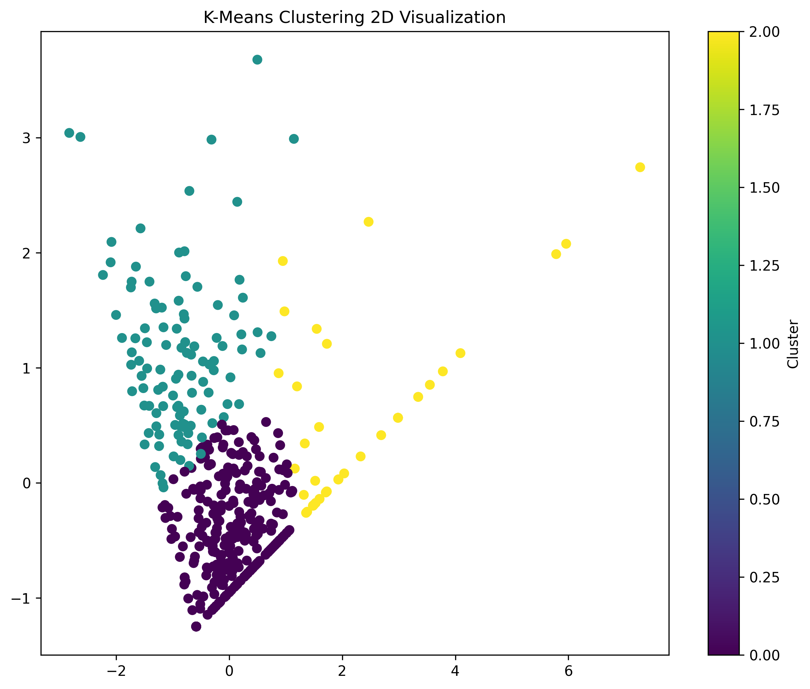

# ⚽ EPL Player Valuation Engine


## 📌 Executive Summary

This repository contains an end-to-end Data Engineering and Machine Learning pipeline designed to extract, process, serve, and analyze football statistics from the 2024-2025 Premier League season. 

**Business Objective ("Moneyball" Approach):** Beyond standard data ingestion, the core impact of this project lies in its **Player Valuation Engine**. By leveraging state-of-the-art predictive modeling (XGBoost), the system accurately predicts a player's market transfer value based on their pitch performance metrics. It then computes the residual errors to automatically flag players as **Undervalued**, **Overvalued**, or **Fair Valued**—providing actionable intelligence for football scouting and recruitment strategy.

## 📂 Project Structure

```text
.
├── data/                                 # 📂 Project data storage
│   ├── database.db                       # 🗄️ Core SQLite database (Master data)
│   ├── max_stats_summary.csv             # 📈 Aggregated league records & benchmarks
│   ├── squad_stats_summary.csv           # 📊 Statistical summary per club
|   |
│   ├── charts/                           # 🖼️ Auto-generated 2D/3D PCA & evaluation plots
│   ├── lookup_ans/                       # 📄 Exported CSVs from the lookup tool
│   └── outputs/                          # 🤖 ML model results and Optuna trials
│       ├── params_trial.db               # 🧠 Optuna optimization history database
│       └── player_valuation_results.csv  # 📉 Predicted vs Actual market valuations
│
├── docs/                               # 📑 Project documentation & reports
│   ├── assignment.md                   # 📋 Project requirements and scope
│   └── report.pdf                      # 🎓 Final technical report
│
├── source_code/
│   ├── part1/                          # 🕷️ Data Crawling System (ETL)
│   │   ├── crawl_data.py               # 🌐 Scraping player performance stats (FBRef)
│   │   └── crawl_transfer.py           # 💶 Scraping market values (Transfermarkt)
│   │
│   ├── part2/                          # 🔌 API & Application Layer
│   │   ├── app.py                      # 🚀 Flask Web Application Server
│   │   └── lookup.py                   # 🔍 CLI/Service for player database searching
│   │
│   └── part3/                          # 🧪 Machine Learning & Analytics Engine
│       ├── clusters.py                 # 💎 KMeans, PCA, and dimensionality reduction
│       ├── evaluation.py               # 📐 Model validation & performance metrics
│       ├── squad_analytics.py          # 🏢 Tactical & financial club-level analysis
|       |
│       └── core/                       # 🧠 Deep ML implementation kernels
│           ├── training.py             # 🔥 XGBoost training with Optuna tuning
│           ├── features.py             # 🛠️ Feature engineering & preprocessing logic
│           ├── config.py               # ⚙️ Global hyperparameters & system constants
│           └── loader.py               # 📥 Data pipeline & cleaning utilities
│
├── requirements.txt                    # 📦 Third-party dependency manifest
└── README.md                           # 📖 Main system documentation
```

## ⚙️ System Architecture & Core Modules

The project is strictly modularized into three distinct subsystems to ensure separation of concerns, scalability, and maintainability.

### Part 1: Automated Data Ingestion (ETL Pipeline)
An intelligent scraping engine that bypasses standard bot protections to fetch real-time player statistics from FBref.
* **Extraction**: Utilizes `SeleniumBase` (Undetected ChromeDriver) to reliably fetch dynamic HTML.
* **Transformation**: Employs `pandas` to clean, normalize, and format multi-level HTML tables, converting strings to numeric types and filtering out invalid entries (e.g., players with <90 minutes played).
* **Loading**: Persists the processed dataset into a robust `SQLite` database (`database.db`).

### Part 2: RESTful Application Interface
A lightweight backend service designed for rapid data retrieval and lookup.
* **Framework**: Built with `Flask`.
* **Endpoints**: Exposes a `/api/search` endpoint allowing precise filtering of player statistics via query parameters (`name` and `club`).
* **Resource Management**: Implements connection pooling and per-request database teardown to ensure thread safety and optimal memory usage.

### Part 3: Advanced Analytics & Machine Learning (Core Technical Achievement)
The analytical heart of the system, implementing both unsupervised and supervised machine learning methodologies to extract deep insights from the player data.
* **Unsupervised Learning (Clustering)**: 
  * Implements `KMeans` clustering to group players based on performance metrics (Goals, Assists, Aggression, Penalty Kicks per 90).
  * Features mathematically rigorous cluster evaluation using **Elbow Methods** and **Silhouette Scores**.
  * Utilizes `PCA` (Principal Component Analysis) for dimensionality reduction, outputting sophisticated 2D and 3D visual representations via `matplotlib`.
* **Supervised Learning (Predictive Modeling)**:
  * Deploys `XGBRegressor` for high-performance regression tasks.
  * Implements Bayesian hyperparameter optimization via `Optuna`, continuously logging trial metrics to a database.
  * Utilizes `RepeatedStratifiedKFold` cross-validation with feature binning to ensure robust model evaluation and prevent overfitting.

## 🛠️ Technology Stack

| Domain | Technologies Used |
| :--- | :--- |
| **Data Extraction** | `seleniumbase`, `lxml`, `beautifulsoup4`, `requests` |
| **Data Manipulation** | `pandas`, `numpy`, `openpyxl` |
| **Backend API** | `Flask`, `SQLAlchemy`, `sqlite3` |
| **Machine Learning** | `scikit-learn`, `xgboost`, `thefuzz` |
| **MLOps & Tuning** | `optuna` |
| **Data Visualization** | `matplotlib`, `seaborn`, `tabulate` |

### Clustering & Dimensionality Reduction (PCA)
<p align="center">
  
</p>

<p align="center">
  
</p>


### Predictive Valuation & Residual Analysis
<p align="center">
  
  
</p>

## 🚀 Installation & Setup

1. **Clone the repository:**
   ```bash
   git clone https://github.com/yourusername/EPL-Player-Valuation-Engine.git
   cd EPL-Player-Valuation-Engine
   ```

2. **Establish a virtual environment (Recommended):**
   ```bash
   python -m venv venv

   # Windows
   venv\Scripts\activate

   # MacOS / Linux
   source venv/bin/activate
   ```

3. **Install exact dependencies:**
   ```bash
   pip install -r requirements.txt
   ```

## 💻 Usage Instructions

The system is designed to be executed in a specific sequence, starting from data acquisition and ending with deep analytical insights.

### Phase 1: Data Acquisition (ETL)
Initialize the system by scraping the latest Premier League performance statistics and market transfer values.
```bash
# Scrape player performance metrics (FBref)
python source_code/part1/crawl_data.py

# Scrape market transfer values
python source_code/part1/crawl_transfer.py
```

### Phase 2: REST API Deployment
Launch the Flask server to expose the processed data through a RESTful interface. This is required for the lookup tool and external queries.
```bash
python source_code/part2/app.py
```

### Phase 3: CLI Data Lookup & Export
Once the API is running, use the dedicated CLI tool to query player statistics and automatically export detailed reports to CSV.
```bash
# Search for a specific player
python source_code/part2/lookup.py --name "Bukayo Saka"

# Search for all players in a specific club
python source_code/part2/lookup.py --club "Arsenal"
```

### Phase 4: Squad-Level Analytics
Generate aggregated statistics for each team and rank squads based on a weighted multivariate performance model.
```bash
python source_code/part3/squad_analytics.py
```

### Phase 5: Predictive Valuation & Model Evaluation
Train the XGBoost regressor using Bayesian optimization (Optuna). This phase calculates the "Fair Value" for players and identifies market anomalies (Undervalued vs. Overvalued players).
```bash
python source_code/part3/evaluation.py
```

### Phase 6: Unsupervised Learning & Clustering
Perform exploratory analysis using KMeans clustering to group players with similar performance archetypes.
```bash
python source_code/part3/clusters.py
```
> **Note:** The script will display Elbow and Silhouette plots. You will be prompted in the terminal to enter the optimal number of clusters (`K`) based on these visualizations.

## 👥 Team Contributions

This project was developed by a team of three engineers. Responsibilities were strictly divided to ensure focus and domain expertise.

| Team Member | Role | Contribution Details |
| :--- | :--- | :--- |
| **LE ANH MINH** *(Leader)* | **ML Architect & Project Lead** | Architected the entire system infrastructure. **Exclusively researched, designed, and developed Part 3.** Implemented advanced mathematical modeling, PCA dimensionality reduction, XGBoost predictive pipelines, and automated Bayesian hyperparameter tuning (Optuna). Designed cross-validation strategies to ensure enterprise-grade model reliability. |
| **NGUYEN DINH ANH QUAN** | Data Engineer | Developed **Part 1**. Handled complex DOM navigation and bot-avoidance protocols using SeleniumBase. Responsible for data cleaning and SQLite schema generation. |
| **UNG TRONG TRINH** | Backend Developer | Developed **Part 2**. Engineered the Flask REST API, optimizing SQLite database connections and implementing the dynamic query filtering logic. |