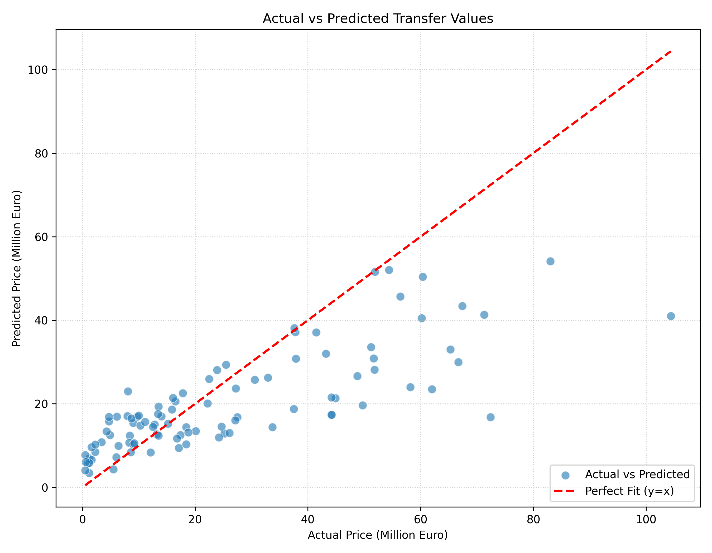
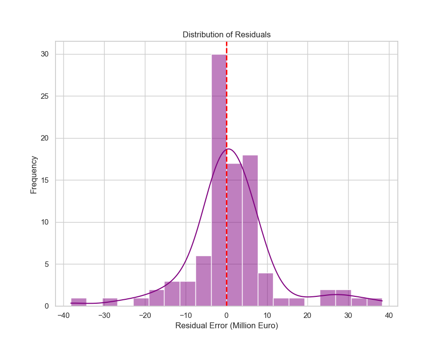

# ⚽ EPL Player Valuation Engine


## 📌 Executive Summary

This repository contains an end-to-end Data Engineering and Machine Learning pipeline designed to extract, process, serve, and analyze football statistics from the 2024-2025 Premier League season. 

**Business Objective ("Moneyball" Approach):** Beyond standard data ingestion, the core impact of this project lies in its **Player Valuation Engine**. By leveraging state-of-the-art predictive modeling (XGBoost), the system accurately predicts a player's market transfer value based on their pitch performance metrics. It then computes the residual errors to automatically flag players as **Undervalued**, **Overvalued**, or **Fair Valued**—providing actionable intelligence for football scouting and recruitment strategy.

## 📂 Project Structure

```text
.
├── data/                       # Local database and generated charts
│   ├── database.db             # Core SQLite database
│   └── charts/                 # Auto-generated 2D/3D PCA & evaluation plots
├── source_code/
│   ├── part1/                  # Data Crawling System
│   │   ├── crawl_data.py       
│   │   └── crawl_transfer.py
│   ├── part2/                  # API & Application Layer
│   │   ├── app.py              # Flask Application
│   │   └── lookup.py
│   └── part3/                  # Machine Learning & Analytics Engine
│       ├── clusters.py         # KMeans, PCA, and plotting logic
│       ├── evaluation.py       
│       ├── squad_analytics.py
│       └── core/               # Deep ML implementations
│           ├── training.py     # XGBoost & Optuna Optimization
│           ├── features.py     
│           ├── config.py       # Global hyperparameters
│           └── loader.py
├── requirements.txt            # Dependency manifest
└── README.md                   # System documentation
```

## ⚙️ System Architecture & Core Modules

The project is strictly modularized into three distinct subsystems to ensure separation of concerns, scalability, and maintainability.

### Part 1: Automated Data Ingestion (ETL Pipeline)
An intelligent scraping engine that bypasses standard bot protections to fetch real-time player statistics from FBref.
* **Extraction**: Utilizes `SeleniumBase` (Undetected ChromeDriver) to reliably fetch dynamic HTML.
* **Transformation**: Employs `pandas` to clean, normalize, and format multi-level HTML tables, converting strings to numeric types and filtering out invalid entries (e.g., players with <90 minutes played).
* **Loading**: Persists the processed dataset into a robust `SQLite` database (`database.db`).

### Part 2: RESTful Application Interface
A lightweight backend service designed for rapid data retrieval and lookup.
* **Framework**: Built with `Flask`.
* **Endpoints**: Exposes a `/api/search` endpoint allowing precise filtering of player statistics via query parameters (`name` and `club`).
* **Resource Management**: Implements connection pooling and per-request database teardown to ensure thread safety and optimal memory usage.

### Part 3: Advanced Analytics & Machine Learning (Core Technical Achievement)
The analytical heart of the system, implementing unsupervised clustering for player profiling and supervised regression for transfer market valuation.

* **Unsupervised Learning (Player Profiling):** * Implements `KMeans` clustering to group players based on engineered metrics (`Aggression_per90`, `Goals_per90`, etc.), utilizing `RobustScaler` to handle outliers.
  * Features mathematically rigorous cluster evaluation using **Elbow Methods** and **Silhouette Scores**.
  * Utilizes `PCA` (Principal Component Analysis) for dimensionality reduction, mapping high-dimensional player stats into interpretable 2D and 3D topological spaces.

* **Supervised Learning (Transfer Value Prediction):**
  * **Target Transformation:** Employs Log-Transformation (`np.log1p`) on the highly skewed transfer value target variable to stabilize variance, reverting via `np.expm1` for final evaluation.
  * **Advanced Cross-Validation:** Deploys a sophisticated `RepeatedStratifiedKFold` approach on continuous data by binning the target variable (`pd.qcut`), ensuring robust model evaluation against highly imbalanced transfer market distributions.
  * **Optimization & Modeling:** Deploys `XGBRegressor` with Bayesian hyperparameter optimization via `Optuna` (logging metrics to SQLite). 
  * **Evaluation & Impact:** Compares the final model against a `DummyRegressor` baseline using RMSE, MAE, and R² scores. Outputs a complete `.csv` report categorizing each player's market status (Undervalued vs. Overvalued) through rigorous residual analysis.

## 🛠️ Technology Stack

| Domain | Technologies Used |
| :--- | :--- |
| **Data Extraction** | `seleniumbase`, `lxml`, `beautifulsoup4`, `requests` |
| **Data Manipulation** | `pandas`, `numpy`, `openpyxl` |
| **Backend API** | `Flask`, `SQLAlchemy`, `sqlite3` |
| **Machine Learning** | `scikit-learn`, `xgboost`, `thefuzz` |
| **MLOps & Tuning** | `optuna` |
| **Data Visualization** | `matplotlib`, `seaborn`, `tabulate` |

### Clustering & Dimensionality Reduction (PCA)
<p align="center">
  
</p>

<p align="center">
  
</p>


### Predictive Valuation & Residual Analysis
<p align="center">
  
  
</p>

## 🚀 Installation & Setup

1. **Clone the repository:**
   ```bash
   git clone https://github.com/yourusername/EPL-Player-Valuation-Engine.git
   cd EPL-Player-Valuation-Engine
   ```

2. **Establish a virtual environment (Recommended):**
   ```bash
   python -m venv venv

   # Windows
   venv\Scripts\activate

   # MacOS / Linux
   source venv/bin/activate
   ```

3. **Install exact dependencies:**
   ```bash
   pip install -r requirements.txt
   ```

## 💻 Usage Instructions

**Run Part 1: Build the Database**
Execute the scraper to generate the `database.db` file.
```bash
python source_code/part1/crawl_data.py
```

**Run Part 2: Launch the API**
Start the local Flask development server to serve queries.
```bash
python source_code/part2/app.py
# Test the API in another terminal: 
# curl "[http://127.0.0.1:5000/api/search?club=Arsenal](http://127.0.0.1:5000/api/search?club=Arsenal)"
```

**Run Part 3: Execute Machine Learning Pipelines**
Run the unsupervised clustering algorithms and generate 2D/3D visualizations.
```bash
python source_code/part3/clusters.py
```
*Note: The CLI will prompt you to input the optimal `K` value based on the generated Elbow/Silhouette charts.*


## 👥 Team Contributions

This project was developed by a team of three engineers. Responsibilities were strictly divided to ensure focus and domain expertise.

| Team Member | Role | Contribution Details |
| :--- | :--- | :--- |
| **LE ANH MINH** *(Leader)* | **ML Architect & Project Lead** | Architected the entire system infrastructure. **Exclusively researched, designed, and developed Part 3.** Implemented advanced mathematical modeling, PCA dimensionality reduction, XGBoost predictive pipelines, and automated Bayesian hyperparameter tuning (Optuna). Designed cross-validation strategies to ensure enterprise-grade model reliability. |
| **NGUYEN DINH ANH QUAN** | Data Engineer | Developed **Part 1**. Handled complex DOM navigation and bot-avoidance protocols using SeleniumBase. Responsible for data cleaning and SQLite schema generation. |
| **UNG TRONG TRINH** | Backend Developer | Developed **Part 2**. Engineered the Flask REST API, optimizing SQLite database connections and implementing the dynamic query filtering logic. |